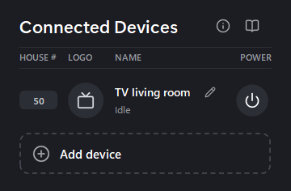

# How does it look?

Every device is one row with the same four columns: House #, Logo, Name and Power.

House # is the last part of the device's IP address. Logo is the device's icon. Name shows the device's name, with a pencil to rename it. Power runs the device's script in the Turn on folder.

The Add device row with the plus is always the last row. A fresh install shows only the headings, "No devices yet" and the Add device row.
