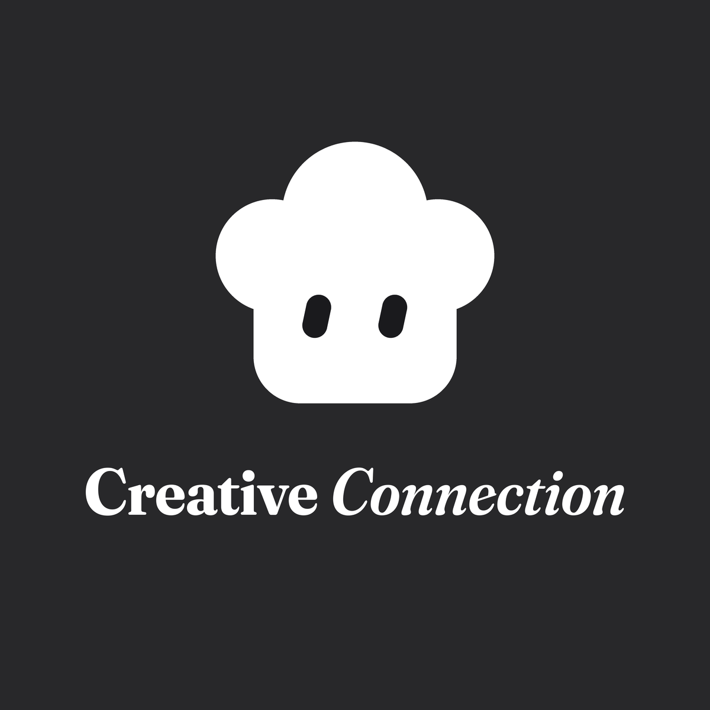
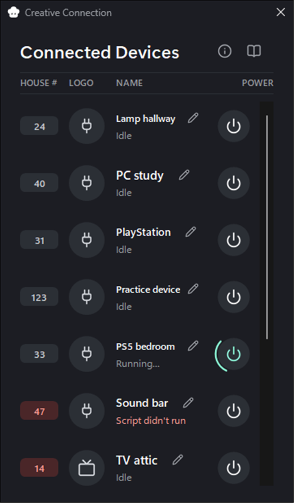
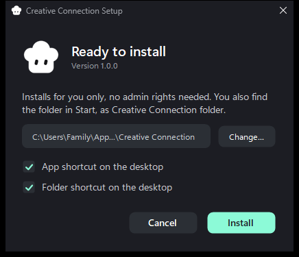
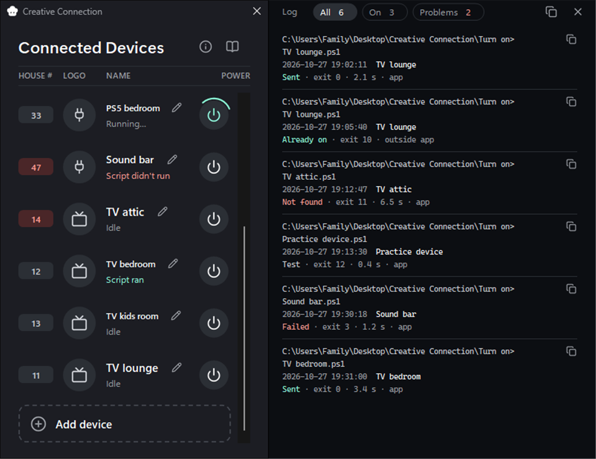
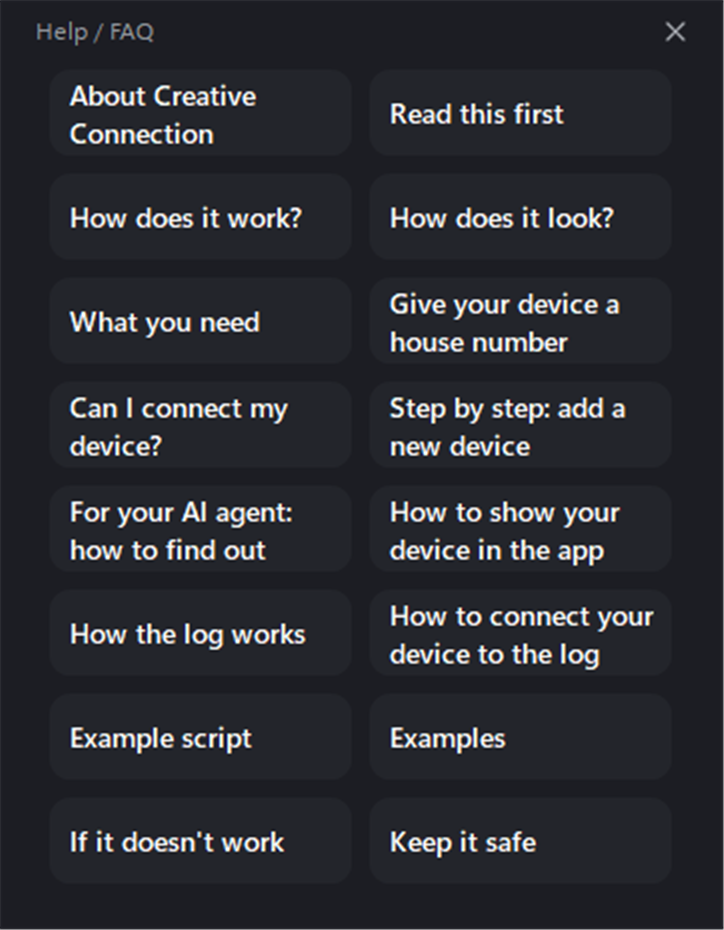

<h1 align="center">Welcome to Creative Connection</h1>

<table>
<tr><td><a href="#introduction">1. Introduction</a></td><td><a href="#why-we-made-it">2. Why we made it</a></td></tr>
<tr><td><a href="#how-to-install">3. How to install</a></td><td><a href="#how-it-works">4. How it works</a></td></tr>
<tr><td><a href="#the-log">5. The log</a></td><td><a href="#help-is-built-in">6. Help is built in</a></td></tr>
<tr><td><a href="#add-your-first-device">7. Add your first device</a></td><td><a href="#for-ai-agents">8. For AI agents</a></td></tr>
<tr><td><a href="#good-to-know">9. Good to know</a></td><td><a href="#license">10. License</a></td></tr>
</table>

## Introduction

✨ Did you ever dream of **all your power buttons in one place?**

The TV in the living room, the console in the kids' room, the lamp in the hallway, the
speaker in the kitchen. Not spread over twenty apps and three remotes, but **right here,
in one small window** on your own computer.

🔌 Every device gets **its own row**: a house number, a little icon, its name and
**one big power button**. Press it, and a small script on your computer sends that
device exactly the message it needs to wake up.

🤖 And here's the fun part: **you press the button, your AI agent runs the script.**
Behind every button is a small script, and your agent can start that very same
script. Just say "turn on the TV", and it does exactly what your button does.

🏠 The app itself never uses the internet. Your scripts decide where their
letters go, usually only inside your home network.

## Why we made it

🤖 One day you ask your AI agent: **"Can you turn on my PS5?"** Or the lamps in the
kitchen. Or the TV in the bedroom, so your show is ready when you walk in.

And then it gets strange. Your agent **can**, and at the same time it **can't**.

**Why it can't:** the button is locked inside the official app. One brand, one app.
Twenty devices, twenty apps. And not one of them lets your agent press the button.

**Why it can:** almost everything that is connected to your home network, with Wi-Fi
or a cable, is listening for a way to wake up. If the settings are right, a small
script on your computer can send it exactly the right message:

- 💡 a **Wake-on-LAN** packet, the classic "wake up!" for PCs, TVs and many other devices
- 🎮 a console's own **wake-up message**, the same one its remote play app sends
- 📺 a TV's own **local control**, the way the remote app on your phone talks to it
- 🔌 a **smart plug** or lamp that listens on your home network

That's why we made Creative Connection: **one window with a button for every device**,
on your own computer. You press the button, your agent runs the script behind it.
Two ways in, one and the same script.

To be honest: getting a stubborn device in there can be a real puzzle. 🧩 Some take
five minutes, some take an evening. So see it as a **challenge for you and your agent
together**. You won't be on your own: the app has a **whole Help section** with
step-by-step guides, an example script and a practice device, so you can learn without
turning anything on by accident.

Lots of devices. **One place.** ✨

## How to install

✨ There are **two ways** to get Creative Connection on your computer. Both give you
**the same folder**: the app, the Help, and the `Turn on` folder for your own scripts.
Pick the one that feels right.

### 🧩 Way 1: the installer (easiest)

1. Go to **Releases** on the right of this page and download
   `Creative Connection Setup.exe`.
2. Double-click it. You see this window:

3. Want the app somewhere else, like Documents? Press **Change…**.
4. Press **Install**. 🎉 The app opens right away and says "No devices yet".

Now you find **Creative Connection** in Start, with **Creative Connection folder** right
next to it. That folder is where your `Turn on` folder lives. The installer works for
you only and needs no admin rights. By default the app goes in
`%LOCALAPPDATA%\Programs\Creative Connection`.

To remove it: Windows Settings, Apps, Creative Connection, Uninstall. Your own
scripts, log and names stay in that folder.

### 📦 Way 2: the whole folder (no installing)

1. Press the green **Code** button at the top of this page and choose
   **Download ZIP**. Or download `Creative Connection.zip` from **Releases**.
2. Unpack it wherever you like, for example in Documents.
3. Double-click `Creative Connection.exe`, the one with the little cloud house.

Like to read first? `Start Creative Connection.cmd` does the same in three lines. Or
run this in a PowerShell window in that folder:

    powershell.exe -NoProfile -ExecutionPolicy Bypass -File "Creative Connection.ps1"

`-ExecutionPolicy Bypass` only applies to that one start. It changes nothing
in Windows. If nothing opens when you double-click, this command is also the way
to see the error message, because it does not hide the window.

### 🛡️ Windows warns you the first time

You see a blue window: "Windows protected your PC". Windows shows it for every new app
that is not signed with a paid certificate. It does not mean something is wrong.
Choose **More info** and then **Run anyway**. Want to be sure first? Read
[Check it yourself](#check-it-yourself).

### Check it yourself

You don't have to take our word for it. Both `.exe` files are built from the code in
`Development\bouwen`, with the C# compiler that is already part of Windows:

- `Creative Connection.exe` only starts `Creative Connection.ps1` next to it. Its code
  is `starter.cs`, about 40 lines.
- `Creative Connection Setup.exe` copies the app into your folder, makes the shortcuts
  and adds the app to the list of apps in Windows. Its code is `installatie.cs`.

To check that both files really come from that code, run this in a PowerShell window
in the app folder:

    powershell.exe -NoProfile -ExecutionPolicy Bypass -File "Development\bouwen\bouw.ps1" -Check -Setup "$HOME\Downloads\Creative Connection Setup.exe"

It builds both files again from the code and compares them byte for byte. "RESULT:
SAME" means they match exactly. You can also let your virus scanner check them, or
ask your AI agent to read the code first.

🔏 Every download also has a fingerprint, a SHA-256, so you can confirm it's the real
one. You find them in `SHA256SUMS.txt`, next to the downloads on the Releases page.
To see the fingerprint of your own download, run:

    Get-FileHash "$HOME\Downloads\Creative Connection Setup.exe"

When both fingerprints are the same, your file is exactly the one we made.

## How it works

🏘️ Think of your home network as **a street**. Your router is **the postman**, and every
device in your house has **its own house number**: the last part of its IP address. In
the list of devices at the top, the TV in the bedroom lives at **number 12** and the PS5 at
**number 33**.

📜 Every button sends **a letter**. That letter is a small PowerShell script in the
`Turn on` folder, one script per device, written in **the language that device
understands**. The file name is the name in the app: `TV bedroom.ps1` becomes the row
"TV bedroom".

📮 You press the button, the script writes its letter, the postman brings it to the
right house number, and the device reads it and **wakes up**. ✨

🚪 Just like with real mail, **someone has to be home to open the door**. If a device is
completely off, the letter just lies on the doormat. So your device has to be in
standby, listening for its letter.

📬 Then the app tells you how it went:

- ✅ **Script ran**: the script did its job.
- 🧪 **Test ran**: a practice run, nothing was sent.
- ❌ **Script didn't run**: something went wrong. The log tells you more.

🔴 A **red house number** means the postman couldn't find the house: the device wasn't
found, or the script failed.

## The log

Every press gets a line in the log, with the time, the result and the exit code.
Lines from your AI agent show up too, marked "outside app". The filters show all
lines, only what turned on, or only the problems. Copy one line, or everything you
see, and give it to your AI agent.

## Help is built in

Press the info button for sixteen short topics: how it works, how to give your
device a house number, adding a device step by step, how the log works, and an
example script.

## Add your first device

1. Copy `Examples\Practice device.ps1` into the `Turn on` folder. It talks to nothing
   and turns nothing on.
2. Close the app and open it again. "Practice device" is now a row, with house
   number 123.
3. Press its button. The app says "Test ran" and the log gets a line with the
   result "test".
4. Read `Examples\Example Turn on script.txt` and the Help topics. Write a script for
   your own device, test it outside the `Turn on` folder, and move it in when it works.

## For AI agents

Start with `AGENTS.md`. It lists what you can check yourself, the exit codes and the
rules. The most important rule: you may run the scripts in `Turn on`, but you never
add or change a script there until the owner has read it and said yes.

## Good to know

- Windows 10 or 11, with Windows PowerShell 5.1 and .NET Framework 4, which are
  already part of Windows. Nothing else to install.
- The app only starts `.ps1` files from the `Turn on` folder, and stops a script that
  runs longer than 60 seconds.
- A script that was downloaded from the internet asks "Start it anyway?" first.
- The app writes only inside its own folder: the log and the names you chose.
- Read every script before you put it in `Turn on`. A script can do anything you can
  do. Never put keys, passwords or pairing codes in the project folder.

## License

Made by Rito, Creative Mind

Copyright 2026 Rito, Creative Mind

Licensed under the Apache License 2.0

You may use it, change it and share it, also in your own projects, as long as you
keep the credits. See `LICENSE` and `NOTICE`.

Found a problem or have an idea? Open an issue. For a security problem, see
`SECURITY.md`.
